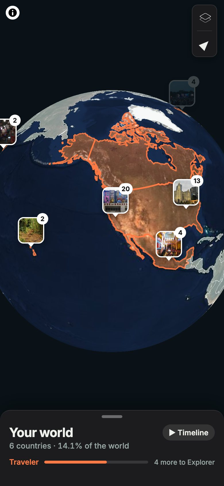
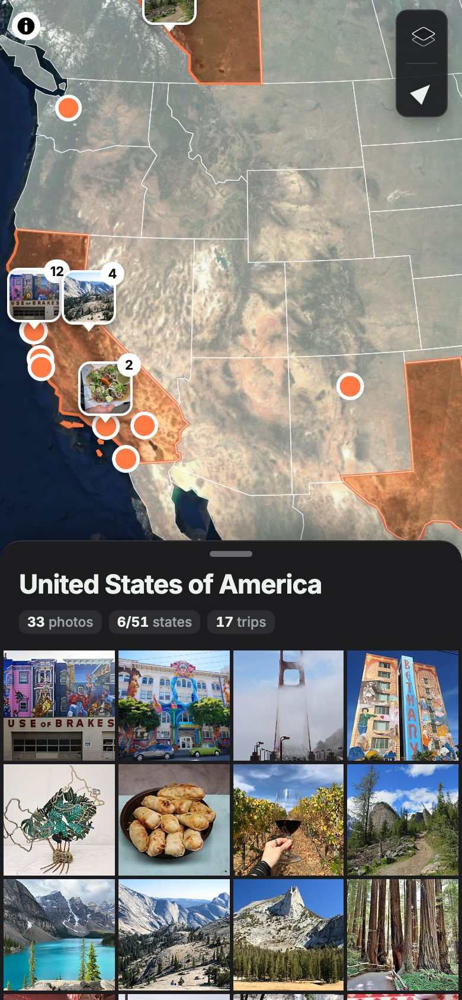
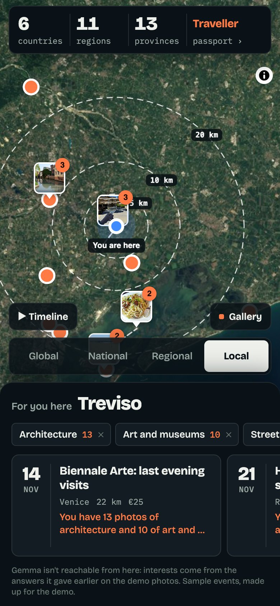
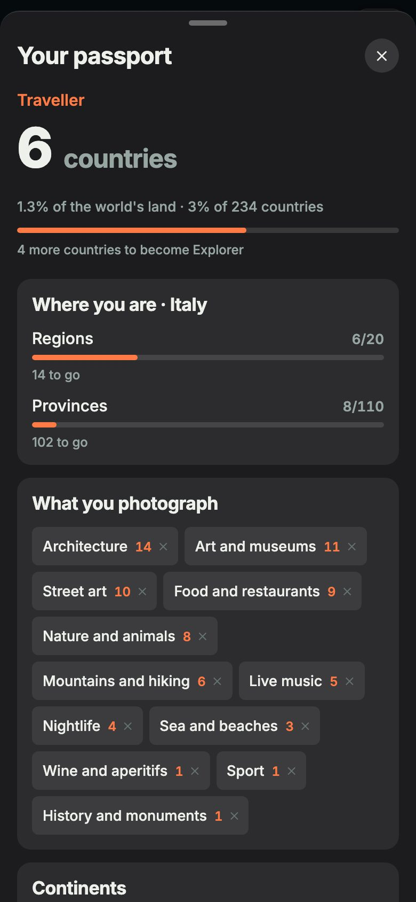

# Mantide

**Where you've been, what you love, what to do nearby: all from the photos you already have.**

[](https://github.com/mattiaroncato2004-bit/mantide/actions/workflows/ci.yml)
[](https://github.com/mattiaroncato2004-bit/mantide/actions/workflows/android.yml)
[](LICENSE)
[](docs/hackathon.md)

<p>
  
  
  
  
</p>

Mantide is an open-source Android app for travellers. It reads the date and GPS of every photo in your gallery and lights up the countries, regions and provinces you've been to. **Gemma 4**, Google's open model, looks at what you photograph to learn what you love, and suggests events near you with the reason ("You have 14 photos of architecture"). Gemma runs on hardware you own: your photos never leave it.

**Try it:** [web demo](https://mattiaroncato2004-bit.github.io/mantide/), a fictional traveller's gallery in your browser. The Android APK comes with the next release.

## What it does

- **A map of where you've been** on a satellite globe: far out the countries you've visited light up, closer their regions, then provinces. Real regions for every country; tap a place to fly into it.
- **Your gallery rebuilds your past:** photos appear where you took them, grouped like the iPhone Photos map; tap a group to see them all.
- **Your photos say what you love:** Gemma 4 labels a sample of your photos with 12 interests; you can remove any of them.
- **Events for you where you're looking,** each with why it was picked and one of your photos that explains it; tap one to see it on the map.
- **A timeline** that replays your journeys, and a **passport** with your level, the share of the world you've seen and what's left.

In English and Italian, following your phone's language.

## Why open source

Your photos and your movements are the most private data there is: where you live, who you're with, where you go every Tuesday night. A closed app asking for them asks for blind trust; an open one lets you check.

- **No server, no account.** Nothing is uploaded; anyone can read the code.
- **Gemma 4 runs locally:** on your own computer today, on the phone itself next (see [roadmap](#status-and-roadmap)).
- **Open data:** MapLibre, Natural Earth, ISTAT boundaries, Sentinel-2 imagery.

## Why

- **Travel trackers charge for the full experience and make you tick boxes by hand:** been Premium $19.99/year, Polarsteps Plus €29.99/year, Fog of World $30 ([market research](docs/market-research.md)).
- **Recommendation apps make you pick a filter** like "art" or "food". Nobody is a macro-category.
- **Your gallery already knows.** Instagram's algorithm knows you because it watches what you do, not what you declare; your gallery is even more honest. Mantide uses that knowledge for you, and only on your hardware.

## How it works

```
Android phone (mobile/: Expo, React Native, TypeScript)
├── Gallery: date and GPS of every photo (expo-media-library, ACCESS_MEDIA_LOCATION)
├── Places: point → country, region, province, offline (src/geo)
├── Map: MapLibre GL JS in a WebView, satellite globe, visited areas, photo thumbnails
├── Interests and suggestions: plain code over Gemma's labels (src/events)
└── Storage: SQLite on the device
        │  each photo shrunk to 384 px, local network only
        ▼
Your computer (local-ai/)
└── Gemma 4 E2B via LiteRT-LM → {"scene": "Mural on a street wall", "interests": ["street-art", "art"]}
```

The same code runs in a browser, where platform-specific pieces have a `.web.ts(x)` twin. That's the web demo.

## Real vs sample

| Part | Status |
|---|---|
| Reading photos, dates and GPS from the gallery | Real |
| Map, regions, visited areas, timeline, passport | Real |
| Interests | Real: Gemma 4 E2B labels a sample of your photos on your hardware |
| Events | **Sample:** 46 invented events around Italy and Europe ([events.json](mobile/src/events/events.json)); real open-data events are next |
| Demo gallery | **Sample:** 45 open-licensed photos with invented GPS and dates for a fictional traveller ([demo-data/](demo-data/)) |
| Web demo | Gemma can't run for a visitor: it shows the answers Gemma gave earlier on the demo photos, and says so |

## Run it

The web version, with the same checks CI runs ([ci.yml](.github/workflows/ci.yml)), using the Node version in [`.nvmrc`](.nvmrc):

```sh
cd mobile
npm ci
npm run typecheck
npm test
npx expo export --platform android --output-dir /tmp/android-bundle   # the Android JavaScript bundle builds
npm run export:web                                                     # the web demo, as published
npx playwright install --with-deps chromium                            # once: the browser for the end-to-end test
npm run e2e                                                            # the web demo, end to end
npx expo start --web                                                   # or develop it at http://localhost:8081
```

On Android, with an emulator or a phone: [docs/android-setup.md](docs/android-setup.md). Gemma 4 on your computer: [local-ai/README.md](local-ai/README.md).

## Status and roadmap

**Verified in CI:**

- **Every push** ([ci.yml](.github/workflows/ci.yml)): typecheck, unit tests, and the web demo end to end.
- **Every push to `main`** ([android.yml](.github/workflows/android.yml)): the Android release APK is built and run on an emulator. The run checks:
  - the welcome screen;
  - the map and its sheet without the gallery, down to the offer to connect it;
  - reading the 45 demo photos from the gallery, down to "6 countries" and the place sheet's suggestions from Gemma's earlier answers;
  - Android's back button, one step at a time: the photo, the grid, the sheet, then out of the app.

**Not yet verified:**

- **A physical Android phone.**
- **Gemma called from a phone.** The emulator test runs without Gemma and checks the fallback to prepared answers.

**Next** ([design](docs/superpowers/specs/2026-11-10-mantide-v1-design.md)):

- A redesign around the iPhone Photos map, with one bottom sheet that follows what you look at.
- Real events from open data, plus places from OpenStreetMap.
- Gemma 4 on the phone itself, with LiteRT-LM, on phones with 8 GB of RAM.
- An APK in Releases.

## Credits

Built by **Mattia Roncato** and **Giorgio Caligiuri** at the Hacktoberfest hack day at H-FARM, 24 October 2026, where it won **Best Open-Source AI Project**. The story of the day: [docs/hackathon.md](docs/hackathon.md). Written with the help of Claude Code; commits it contributed to are marked as co-authored.

- [Gemma 4](https://ai.google.dev/gemma) by Google (Apache 2.0), run with [LiteRT-LM](https://developers.google.com/edge/litert-lm)
- [MapLibre GL JS](https://maplibre.org) (BSD-3-Clause)
- Satellite imagery: [Sentinel-2 cloudless 2016](https://s2maps.eu) by EOX IT Services (CC BY 4.0), contains modified Copernicus Sentinel data
- Boundaries and place names: [Natural Earth](https://www.naturalearthdata.com) (public domain) and [openpolis/geojson-italy](https://github.com/openpolis/geojson-italy) (CC BY 4.0, ISTAT data), see [mobile/src/geo/README.md](mobile/src/geo/README.md)
- Demo photos: Wikimedia Commons authors, listed in [demo-data/CREDITS.md](demo-data/CREDITS.md)

## License

[Apache-2.0](LICENSE)
